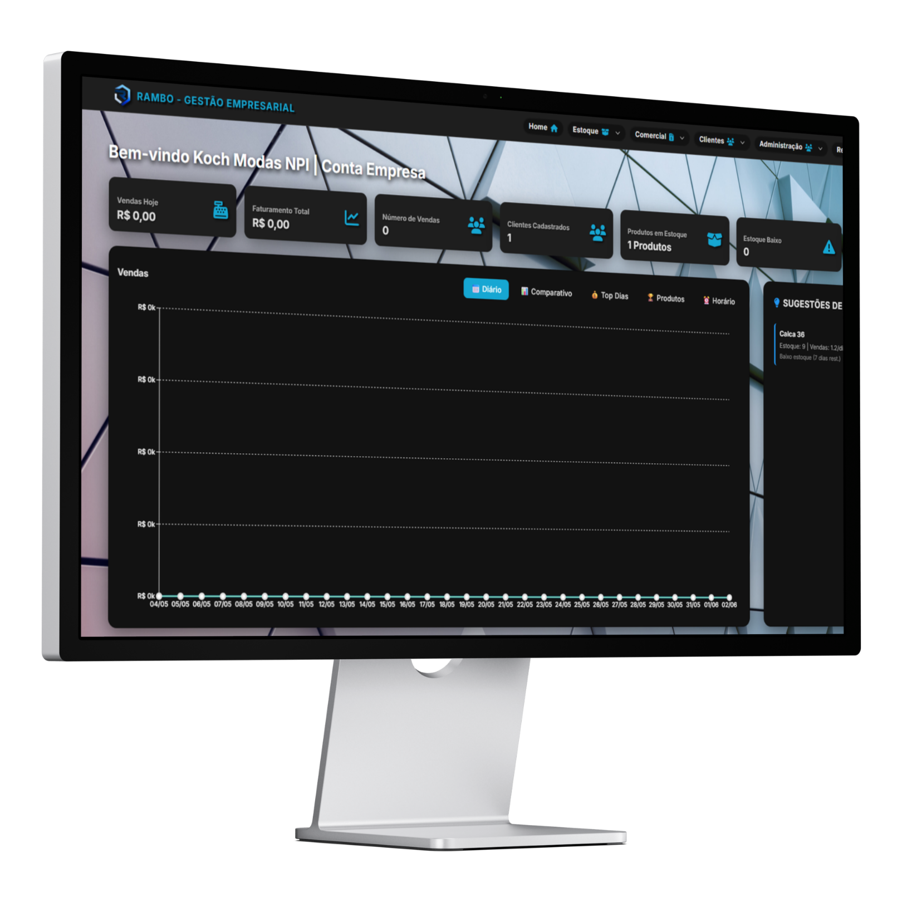

# Rambo Landing Page — Implementation Plan

> **For agentic workers:** REQUIRED SUB-SKILL: Use superpowers:subagent-driven-development (recommended) or superpowers:executing-plans to implement this plan task-by-task. Steps use checkbox (`- [ ]`) syntax for tracking.

**Goal:** Build a single-page React landing page for Rambo Sistemas de Gestão with dark glassmorphism design, Framer Motion animations, WhatsApp CTA, and a contact form that dispatches email via EmailJS.

**Architecture:** Vite + React SPA. Eight standalone components assembled in App.jsx. Tailwind CSS with a custom navy/cyan palette. Framer Motion for scroll-triggered and mount animations. EmailJS handles form-to-email with no backend.

**Tech Stack:** React 18, Vite, Tailwind CSS v3, Framer Motion, @emailjs/browser, Lucide React

---

## File Map

| File | Responsibility |
|---|---|
| `public/mock.png` | Monitor mockup image (move from root) |
| `public/rambo_logo.svg` | Logo (move from root) |
| `src/index.css` | Global styles, Tailwind directives, glass/btn utilities |
| `tailwind.config.js` | Custom color palette + font |
| `src/App.jsx` | Root shell — assembles all components |
| `src/components/Background.jsx` | Fixed animated gradient background |
| `src/components/Navbar.jsx` | Fixed top nav with scroll-aware glassmorphism |
| `src/components/Hero.jsx` | Headline + CTAs + floating monitor mockup |
| `src/components/Features.jsx` | 11-card grid of ERP modules |
| `src/components/Diferenciais.jsx` | 3-card "why Rambo" highlights |
| `src/components/CtaBanner.jsx` | Mid-page WhatsApp CTA card |
| `src/components/Contact.jsx` | EmailJS form + WhatsApp card side-by-side |
| `src/components/FloatingWhatsApp.jsx` | Fixed bottom-right WhatsApp button |
| `src/components/Footer.jsx` | Logo + links + contact |
| `.env` | EmailJS credentials (user fills in) |
| `index.html` | SEO meta tags + favicon |

---

## Task 1: Project Scaffolding

**Files:**
- Create: `package.json`, `vite.config.js`, `index.html`, `src/main.jsx`, `src/App.jsx`

- [ ] **Step 1: Scaffold Vite React project in current directory**

```bash
npm create vite@latest . -- --template react
```

When prompted about non-empty directory — choose to keep existing files.

Expected: `package.json`, `vite.config.js`, `index.html`, `src/` created alongside existing `mock.png` and `rambo_logo.svg`.

- [ ] **Step 2: Install base dependencies**

```bash
npm install
```

Expected: `node_modules/` created, no errors.

- [ ] **Step 3: Verify dev server starts**

```bash
npm run dev
```

Expected: Vite dev server running at `http://localhost:5173` with default React page.

- [ ] **Step 4: Commit scaffolding**

```bash
git init
git add .
git commit -m "chore: scaffold Vite React project"
```

---

## Task 2: Install Dependencies and Configure Tailwind

**Files:**
- Create: `tailwind.config.js`, `postcss.config.js`, `.env`
- Modify: `src/index.css`, `src/App.jsx`

- [ ] **Step 1: Install Tailwind CSS**

```bash
npm install -D tailwindcss postcss autoprefixer
npx tailwindcss init -p
```

Expected: `tailwind.config.js` and `postcss.config.js` created.

- [ ] **Step 2: Install runtime dependencies**

```bash
npm install framer-motion @emailjs/browser lucide-react
```

Expected: All three packages installed. No peer dependency errors.

- [ ] **Step 3: Move assets to public/**

Run in PowerShell:

```powershell
Move-Item mock.png public/mock.png
Move-Item rambo_logo.svg public/rambo_logo.svg
```

Expected: Both files now inside `public/`.

- [ ] **Step 4: Replace tailwind.config.js**

```js
/** @type {import('tailwindcss').Config} */
export default {
  content: ['./index.html', './src/**/*.{js,jsx}'],
  theme: {
    extend: {
      colors: {
        navy: {
          deep: '#041D33',
          mid:  '#0B3562',
          accent: '#002E53',
          dark: '#011B72',
        },
        primary: '#0153A7',
        cyan: '#7BCFF3',
        'text-primary':   '#E8ECF5',
        'text-secondary': '#9FB3DB',
      },
      fontFamily: {
        inter: ['Inter', 'sans-serif'],
      },
    },
  },
  plugins: [],
}
```

- [ ] **Step 5: Replace src/index.css**

```css
@import url('https://fonts.googleapis.com/css2?family=Inter:wght@300;400;500;600;700;800&display=swap');

@tailwind base;
@tailwind components;
@tailwind utilities;

@layer base {
  *, *::before, *::after { box-sizing: border-box; }
  html { scroll-behavior: smooth; }
  body {
    font-family: 'Inter', sans-serif;
    background-color: #041D33;
    color: #E8ECF5;
    overflow-x: hidden;
  }
}

@layer utilities {
  .glass {
    background: rgba(255, 255, 255, 0.05);
    backdrop-filter: blur(12px);
    -webkit-backdrop-filter: blur(12px);
    border: 1px solid rgba(123, 207, 243, 0.15);
  }
  .glass-strong {
    background: rgba(255, 255, 255, 0.08);
    backdrop-filter: blur(20px);
    -webkit-backdrop-filter: blur(20px);
    border: 1px solid rgba(123, 207, 243, 0.25);
  }
  .gradient-text {
    background: linear-gradient(135deg, #E8ECF5, #7BCFF3);
    -webkit-background-clip: text;
    -webkit-text-fill-color: transparent;
    background-clip: text;
  }
  .btn-primary {
    background: linear-gradient(135deg, #0153A7, #7BCFF3);
    transition: all 0.3s ease;
  }
  .btn-primary:hover {
    box-shadow: 0 0 24px rgba(123, 207, 243, 0.4);
    transform: translateY(-1px);
  }
}
```

- [ ] **Step 6: Replace src/App.jsx with clean shell**

```jsx
import './index.css'

function App() {
  return (
    <div className="min-h-screen bg-navy-deep font-inter">
      <p className="text-text-primary p-4">Rambo Landing Page</p>
    </div>
  )
}

export default App
```

- [ ] **Step 7: Create .env file**

```
VITE_EMAILJS_SERVICE_ID=your_service_id
VITE_EMAILJS_TEMPLATE_ID=your_template_id
VITE_EMAILJS_PUBLIC_KEY=your_public_key
```

Note: User fills in real credentials from emailjs.com before testing the form.

- [ ] **Step 8: Verify Tailwind in browser**

Run `npm run dev`. Expected: Dark navy background (`#041D33`), white "Rambo Landing Page" text.

- [ ] **Step 9: Commit**

```bash
git add .
git commit -m "chore: install deps, configure Tailwind with Rambo color palette"
```

---

## Task 3: Animated Background

**Files:**
- Create: `src/components/Background.jsx`
- Modify: `src/App.jsx`

- [ ] **Step 1: Create src/components/Background.jsx**

```jsx
export default function Background() {
  return (
    <div className="fixed inset-0 -z-10 overflow-hidden">
      <div
        className="absolute inset-0"
        style={{
          background: 'linear-gradient(135deg, #041D33 0%, #011B72 40%, #0B3562 70%, #002E53 100%)',
          backgroundSize: '400% 400%',
          animation: 'gradientShift 20s ease infinite',
        }}
      />
      <div
        className="absolute -top-40 -right-40 w-96 h-96 rounded-full"
        style={{
          background: 'radial-gradient(circle, #7BCFF3, transparent 70%)',
          opacity: 0.15,
          animation: 'glowPulse 8s ease-in-out infinite',
        }}
      />
      <div
        className="absolute -bottom-40 -left-40 w-80 h-80 rounded-full"
        style={{
          background: 'radial-gradient(circle, #0153A7, transparent 70%)',
          opacity: 0.1,
          animation: 'glowPulse 10s ease-in-out infinite reverse',
        }}
      />
      <style>{`
        @keyframes gradientShift {
          0%   { background-position: 0% 50%; }
          50%  { background-position: 100% 50%; }
          100% { background-position: 0% 50%; }
        }
        @keyframes glowPulse {
          0%, 100% { transform: scale(1); }
          50%       { transform: scale(1.25); }
        }
      `}</style>
    </div>
  )
}
```

- [ ] **Step 2: Update src/App.jsx**

```jsx
import './index.css'
import Background from './components/Background'

function App() {
  return (
    <div className="min-h-screen font-inter relative">
      <Background />
      <p className="text-text-primary p-4">Rambo Landing Page</p>
    </div>
  )
}

export default App
```

- [ ] **Step 3: Verify in browser**

Expected: Slow-shifting gradient background with soft cyan glow top-right. Background covers full viewport and stays fixed on scroll.

- [ ] **Step 4: Commit**

```bash
git add src/components/Background.jsx src/App.jsx
git commit -m "feat: add animated gradient background"
```

---

## Task 4: Navbar

**Files:**
- Create: `src/components/Navbar.jsx`
- Modify: `src/App.jsx`

- [ ] **Step 1: Create src/components/Navbar.jsx**

```jsx
import { useState, useEffect } from 'react'
import { motion } from 'framer-motion'
import { MessageCircle } from 'lucide-react'

const WA_URL = 'https://wa.me/5546999167623?text=Ol%C3%A1!%20Tenho%20interesse%20no%20Rambo%20ERP%20e%20gostaria%20de%20saber%20mais.'

export default function Navbar() {
  const [scrolled, setScrolled] = useState(false)

  useEffect(() => {
    const handle = () => setScrolled(window.scrollY > 20)
    window.addEventListener('scroll', handle)
    return () => window.removeEventListener('scroll', handle)
  }, [])

  return (
    <motion.nav
      initial={{ y: -80, opacity: 0 }}
      animate={{ y: 0, opacity: 1 }}
      transition={{ duration: 0.5 }}
      className={`fixed top-0 left-0 right-0 z-50 transition-all duration-300 ${
        scrolled ? 'glass border-b border-cyan/10 py-3' : 'bg-transparent py-5'
      }`}
    >
      <div className="max-w-7xl mx-auto px-6 flex items-center justify-between">
        <a href="/" className="flex items-center gap-3">
          
          <div className="leading-tight">
            <p className="text-text-primary font-bold text-sm tracking-widest uppercase">Rambo</p>
            <p className="text-text-secondary text-xs tracking-wider">Gestão Empresarial</p>
          </div>
        </a>

        <div className="flex items-center gap-3">
          <a
            href="https://portal.ramboerp.com.br"
            target="_blank"
            rel="noopener noreferrer"
            className="hidden sm:block text-text-secondary hover:text-cyan text-sm font-medium transition-colors duration-200"
          >
            Acessar o Sistema
          </a>
          <a
            href={WA_URL}
            target="_blank"
            rel="noopener noreferrer"
            className="flex items-center gap-2 btn-primary text-white text-sm font-semibold px-4 py-2 rounded-lg"
          >
            <MessageCircle size={16} />
            <span className="hidden sm:inline">WhatsApp</span>
          </a>
        </div>
      </div>
    </motion.nav>
  )
}
```

- [ ] **Step 2: Update src/App.jsx**

```jsx
import './index.css'
import Background from './components/Background'
import Navbar from './components/Navbar'

function App() {
  return (
    <div className="min-h-screen font-inter relative">
      <Background />
      <Navbar />
      <main className="pt-24">
        <p className="text-text-primary p-6">Content coming soon</p>
      </main>
    </div>
  )
}

export default App
```

- [ ] **Step 3: Verify in browser**

Scroll down and back up. Expected: Navbar transparent at top, becomes glass with border on scroll. Logo and "Acessar o Sistema" link visible on desktop. WhatsApp button with gradient background.

- [ ] **Step 4: Commit**

```bash
git add src/components/Navbar.jsx src/App.jsx
git commit -m "feat: add scroll-aware glassmorphism Navbar"
```

---

## Task 5: Hero Section

**Files:**
- Create: `src/components/Hero.jsx`
- Modify: `src/App.jsx`

- [ ] **Step 1: Create src/components/Hero.jsx**

```jsx
import { motion } from 'framer-motion'
import { MessageCircle, ChevronDown } from 'lucide-react'

const WA_URL = 'https://wa.me/5546999167623?text=Ol%C3%A1!%20Tenho%20interesse%20no%20Rambo%20ERP%20e%20gostaria%20de%20saber%20mais.'

const container = {
  hidden: {},
  visible: { transition: { staggerChildren: 0.15 } },
}

const item = {
  hidden:  { opacity: 0, y: 30 },
  visible: { opacity: 1, y: 0, transition: { duration: 0.6, ease: 'easeOut' } },
}

export default function Hero() {
  return (
    <section id="hero" className="min-h-screen flex items-center pt-20 pb-12 px-6">
      <div className="max-w-7xl mx-auto w-full grid grid-cols-1 lg:grid-cols-2 gap-12 items-center">

        {/* Text */}
        <motion.div variants={container} initial="hidden" animate="visible" className="flex flex-col gap-6">
          <motion.div variants={item}>
            <span className="inline-block glass text-cyan text-xs font-semibold px-4 py-2 rounded-full tracking-widest uppercase">
              ERP Completo para Qualquer Negócio
            </span>
          </motion.div>

          <motion.h1 variants={item} className="text-4xl md:text-5xl xl:text-6xl font-bold leading-tight">
            Gerencie sua empresa com{' '}
            <span className="gradient-text">inteligência</span> e simplicidade
          </motion.h1>

          <motion.p variants={item} className="text-text-secondary text-lg leading-relaxed max-w-xl">
            Do estoque ao financeiro, das ordens de serviço aos seus funcionários — tudo em um único sistema.{' '}
            <span className="text-cyan font-semibold">Implementação gratuita no mesmo dia.</span>
          </motion.p>

          <motion.div variants={item} className="flex flex-wrap gap-4 pt-2">
            <a
              href={WA_URL}
              target="_blank"
              rel="noopener noreferrer"
              className="flex items-center gap-2 btn-primary text-white font-semibold px-6 py-3 rounded-lg text-base"
            >
              <MessageCircle size={20} />
              Falar com a Gerência
            </a>
            <a
              href="#features"
              className="flex items-center gap-2 border border-cyan/30 text-text-primary hover:bg-cyan/10 font-semibold px-6 py-3 rounded-lg text-base transition-all duration-200"
            >
              Conhecer o Sistema
              <ChevronDown size={18} />
            </a>
          </motion.div>
        </motion.div>

        {/* Monitor Mockup */}
        <motion.div
          className="flex justify-center lg:justify-end"
          initial={{ opacity: 0, scale: 0.9 }}
          animate={{ opacity: 1, scale: 1 }}
          transition={{ duration: 0.8, delay: 0.3 }}
        >
          <motion.div
            animate={{ y: [0, -14, 0] }}
            transition={{ duration: 4, repeat: Infinity, ease: 'easeInOut' }}
            className="relative"
          >
            <div
              className="absolute inset-0 rounded-full blur-3xl"
              style={{ background: 'radial-gradient(circle, #7BCFF3, #0153A7)', opacity: 0.2 }}
            />
            
          </motion.div>
        </motion.div>

      </div>
    </section>
  )
}
```

- [ ] **Step 2: Update src/App.jsx**

```jsx
import './index.css'
import Background from './components/Background'
import Navbar from './components/Navbar'
import Hero from './components/Hero'

function App() {
  return (
    <div className="min-h-screen font-inter relative">
      <Background />
      <Navbar />
      <main>
        <Hero />
      </main>
    </div>
  )
}

export default App
```

- [ ] **Step 3: Verify in browser**

Expected: Hero fills the viewport. Text block on left animates in staggered from bottom. Monitor image (`mock.png`) floats up/down continuously on the right. On mobile viewport (< 1024px), stacks vertically. Both CTA buttons visible and clickable.

- [ ] **Step 4: Commit**

```bash
git add src/components/Hero.jsx src/App.jsx
git commit -m "feat: add Hero section with floating monitor mockup and staggered text"
```

---

## Task 6: Features Grid

**Files:**
- Create: `src/components/Features.jsx`
- Modify: `src/App.jsx`

- [ ] **Step 1: Create src/components/Features.jsx**

```jsx
import { useRef } from 'react'
import { motion, useInView } from 'framer-motion'
import {
  Package, Receipt, Monitor, BarChart2, DollarSign, Users,
  UserCheck, Star, FileText, ClipboardList, ShoppingBag,
} from 'lucide-react'

const FEATURES = [
  { icon: Package,       title: 'Controle de Estoque',      desc: 'Entradas, saídas e inventário em tempo real com alertas de reposição.' },
  { icon: Receipt,       title: 'Emissão de Nota Fiscal',   desc: 'NF-e integrada direto no sistema, sem ferramentas externas.' },
  { icon: Monitor,       title: 'PDV / Frente de Caixa',    desc: 'Vendas rápidas e controle total do ponto de venda.' },
  { icon: BarChart2,     title: 'Relatórios Gerenciais',    desc: 'Dados em tempo real para decisões estratégicas e planejamento.' },
  { icon: DollarSign,    title: 'Controle Financeiro',      desc: 'Fluxo de caixa, contas a pagar e receber em um painel único.' },
  { icon: Users,         title: 'Gestão de Clientes',       desc: 'Histórico completo de compras e ferramentas de fidelização.' },
  { icon: UserCheck,     title: 'Controle de Funcionários', desc: 'Ponto eletrônico, metas e acompanhamento de performance.' },
  { icon: Star,          title: 'Sistema de Gratificação',  desc: 'Incentive sua equipe com métricas e bônus automatizados.' },
  { icon: FileText,      title: 'Emissão de Orçamentos',    desc: 'Gere propostas profissionais em segundos e converta mais vendas.' },
  { icon: ClipboardList, title: 'Ordens de Serviço',        desc: 'Acompanhe cada serviço do início ao fim com histórico detalhado.' },
  { icon: ShoppingBag,   title: 'Condicionais',             desc: 'Gerencie empréstimos de produtos para experimentação em casa.' },
]

function FeatureCard({ feature, index }) {
  const ref = useRef(null)
  const inView = useInView(ref, { once: true, margin: '-60px' })
  const Icon = feature.icon

  return (
    <motion.div
      ref={ref}
      initial={{ opacity: 0, y: 30 }}
      animate={inView ? { opacity: 1, y: 0 } : {}}
      transition={{ duration: 0.5, delay: (index % 3) * 0.1 }}
      whileHover={{ y: -4, borderColor: 'rgba(123,207,243,0.4)' }}
      className="glass rounded-2xl p-6 flex flex-col gap-4 cursor-default"
    >
      <div
        className="w-12 h-12 rounded-xl flex items-center justify-center flex-shrink-0"
        style={{ background: 'linear-gradient(135deg, #0153A7, #7BCFF3)' }}
      >
        <Icon size={22} color="white" />
      </div>
      <div>
        <h3 className="text-text-primary font-semibold text-base mb-1">{feature.title}</h3>
        <p className="text-text-secondary text-sm leading-relaxed">{feature.desc}</p>
      </div>
    </motion.div>
  )
}

export default function Features() {
  const titleRef = useRef(null)
  const titleInView = useInView(titleRef, { once: true })

  return (
    <section id="features" className="py-24 px-6">
      <div className="max-w-7xl mx-auto">
        <motion.div
          ref={titleRef}
          initial={{ opacity: 0, y: 20 }}
          animate={titleInView ? { opacity: 1, y: 0 } : {}}
          transition={{ duration: 0.6 }}
          className="text-center mb-16"
        >
          <h2 className="text-3xl md:text-4xl font-bold text-text-primary mb-4">
            Tudo que sua empresa precisa,{' '}
            <span className="gradient-text">em um só lugar</span>
          </h2>
          <p className="text-text-secondary text-lg max-w-2xl mx-auto">
            Módulos completos para cada área do seu negócio, integrados e prontos para usar no dia 1.
          </p>
        </motion.div>

        <div className="grid grid-cols-1 sm:grid-cols-2 lg:grid-cols-3 gap-5">
          {FEATURES.map((f, i) => (
            <FeatureCard key={f.title} feature={f} index={i} />
          ))}
        </div>
      </div>
    </section>
  )
}
```

- [ ] **Step 2: Update src/App.jsx**

```jsx
import './index.css'
import Background from './components/Background'
import Navbar from './components/Navbar'
import Hero from './components/Hero'
import Features from './components/Features'

function App() {
  return (
    <div className="min-h-screen font-inter relative">
      <Background />
      <Navbar />
      <main>
        <Hero />
        <Features />
      </main>
    </div>
  )
}

export default App
```

- [ ] **Step 3: Verify in browser**

Scroll past Hero. Expected: Section heading animates in. 11 cards appear in a 3-column grid (desktop). Each card has a gradient icon box, title, and description. Cards lift slightly on hover.

- [ ] **Step 4: Commit**

```bash
git add src/components/Features.jsx src/App.jsx
git commit -m "feat: add Features grid with 11 ERP modules"
```

---

## Task 7: Diferenciais Section

**Files:**
- Create: `src/components/Diferenciais.jsx`
- Modify: `src/App.jsx`

- [ ] **Step 1: Create src/components/Diferenciais.jsx**

```jsx
import { motion } from 'framer-motion'
import { Zap, Gift, Layers } from 'lucide-react'

const CARDS = [
  {
    icon: Zap,
    title: 'Implementação no Mesmo Dia',
    desc: 'Entre em contato hoje e comece a usar o sistema ainda hoje. Nossa equipe realiza a implementação completa em horas.',
  },
  {
    icon: Gift,
    title: 'Implementação Gratuita',
    desc: 'Sem custo de implantação, sem taxas de adesão. Você paga apenas pelo uso contínuo do sistema.',
  },
  {
    icon: Layers,
    title: 'Para Qualquer Negócio',
    desc: 'O Rambo se adapta à realidade da sua empresa. Qualquer segmento, qualquer porte.',
  },
]

export default function Diferenciais() {
  return (
    <section className="py-24 px-6">
      <div className="max-w-7xl mx-auto">
        <motion.div
          initial={{ opacity: 0, y: 20 }}
          whileInView={{ opacity: 1, y: 0 }}
          viewport={{ once: true }}
          transition={{ duration: 0.6 }}
          className="text-center mb-16"
        >
          <h2 className="text-3xl md:text-4xl font-bold text-text-primary mb-4">
            Por que escolher o <span className="gradient-text">Rambo?</span>
          </h2>
          <p className="text-text-secondary text-lg max-w-xl mx-auto">
            Vantagens que fazem a diferença desde o primeiro contato.
          </p>
        </motion.div>

        <div className="grid grid-cols-1 md:grid-cols-3 gap-6">
          {CARDS.map((card, i) => {
            const Icon = card.icon
            return (
              <motion.div
                key={card.title}
                initial={{ opacity: 0, y: 40 }}
                whileInView={{ opacity: 1, y: 0 }}
                viewport={{ once: true, margin: '-60px' }}
                transition={{ duration: 0.6, delay: i * 0.15 }}
                className="glass-strong rounded-2xl p-8 flex flex-col gap-5 text-center"
                style={{ boxShadow: '0 0 40px rgba(1,83,167,0.1)' }}
              >
                <div
                  className="w-16 h-16 rounded-2xl mx-auto flex items-center justify-center"
                  style={{
                    background: 'linear-gradient(135deg, #0153A7, #7BCFF3)',
                    boxShadow: '0 0 20px rgba(123,207,243,0.3)',
                  }}
                >
                  <Icon size={32} color="white" />
                </div>
                <h3 className="text-text-primary font-bold text-xl">{card.title}</h3>
                <p className="text-text-secondary leading-relaxed">{card.desc}</p>
              </motion.div>
            )
          })}
        </div>
      </div>
    </section>
  )
}
```

- [ ] **Step 2: Update src/App.jsx**

```jsx
import './index.css'
import Background from './components/Background'
import Navbar from './components/Navbar'
import Hero from './components/Hero'
import Features from './components/Features'
import Diferenciais from './components/Diferenciais'

function App() {
  return (
    <div className="min-h-screen font-inter relative">
      <Background />
      <Navbar />
      <main>
        <Hero />
        <Features />
        <Diferenciais />
      </main>
    </div>
  )
}

export default App
```

- [ ] **Step 3: Verify in browser**

Scroll past Features. Expected: 3 large glassmorphism cards appearing with staggered animation. Each card has a large gradient icon (64px), bold title, and description. Cards slide up from below on scroll.

- [ ] **Step 4: Commit**

```bash
git add src/components/Diferenciais.jsx src/App.jsx
git commit -m "feat: add Diferenciais section with 3 key value props"
```

---

## Task 8: CTA Banner

**Files:**
- Create: `src/components/CtaBanner.jsx`
- Modify: `src/App.jsx`

- [ ] **Step 1: Create src/components/CtaBanner.jsx**

```jsx
import { motion } from 'framer-motion'
import { MessageCircle } from 'lucide-react'

const WA_URL = 'https://wa.me/5546999167623?text=Ol%C3%A1!%20Tenho%20interesse%20no%20Rambo%20ERP%20e%20gostaria%20de%20saber%20mais.'

export default function CtaBanner() {
  return (
    <section className="py-20 px-6">
      <div className="max-w-4xl mx-auto">
        <motion.div
          initial={{ opacity: 0, scale: 0.97 }}
          whileInView={{ opacity: 1, scale: 1 }}
          viewport={{ once: true, margin: '-80px' }}
          transition={{ duration: 0.6 }}
          className="rounded-3xl p-12 text-center"
          style={{
            background: 'linear-gradient(135deg, rgba(1,83,167,0.3), rgba(123,207,243,0.1))',
            border: '1px solid rgba(123,207,243,0.3)',
            boxShadow: '0 0 60px rgba(1,83,167,0.2), inset 0 1px 0 rgba(255,255,255,0.05)',
          }}
        >
          <h2 className="text-3xl md:text-4xl font-bold text-text-primary mb-4">
            Pronto para transformar<br />
            <span className="gradient-text">sua gestão?</span>
          </h2>
          <p className="text-text-secondary text-lg mb-8 max-w-xl mx-auto">
            Implementação gratuita. Sem taxa de adesão. Comece hoje.
          </p>
          <a
            href={WA_URL}
            target="_blank"
            rel="noopener noreferrer"
            className="inline-flex items-center gap-3 btn-primary text-white font-bold px-8 py-4 rounded-xl text-lg"
          >
            <MessageCircle size={22} />
            Falar com a Gerência no WhatsApp
          </a>
        </motion.div>
      </div>
    </section>
  )
}
```

- [ ] **Step 2: Update src/App.jsx**

```jsx
import './index.css'
import Background from './components/Background'
import Navbar from './components/Navbar'
import Hero from './components/Hero'
import Features from './components/Features'
import Diferenciais from './components/Diferenciais'
import CtaBanner from './components/CtaBanner'

function App() {
  return (
    <div className="min-h-screen font-inter relative">
      <Background />
      <Navbar />
      <main>
        <Hero />
        <Features />
        <Diferenciais />
        <CtaBanner />
      </main>
    </div>
  )
}

export default App
```

- [ ] **Step 3: Verify in browser**

Scroll past Diferenciais. Expected: Centered card with gradient border, headline in two lines, subtitle, and large WhatsApp button. Scales in from slightly smaller on viewport entry.

- [ ] **Step 4: Commit**

```bash
git add src/components/CtaBanner.jsx src/App.jsx
git commit -m "feat: add CTA Banner with WhatsApp deep link"
```

---

## Task 9: Contact Section with EmailJS Form

**Files:**
- Create: `src/components/Contact.jsx`
- Modify: `src/App.jsx`

- [ ] **Step 1: Create src/components/Contact.jsx**

```jsx
import { useState, useRef } from 'react'
import { motion, useInView } from 'framer-motion'
import emailjs from '@emailjs/browser'
import { Send, MessageCircle, CheckCircle, AlertCircle } from 'lucide-react'

const WA_URL = 'https://wa.me/5546999167623?text=Ol%C3%A1!%20Tenho%20interesse%20no%20Rambo%20ERP%20e%20gostaria%20de%20saber%20mais.'

const EMPTY = { name: '', company: '', segment: '', phone: '' }

const inputClass =
  'w-full glass rounded-xl px-4 py-3 text-text-primary placeholder-text-secondary/60 ' +
  'border border-cyan/10 focus:border-cyan/40 focus:outline-none focus:ring-1 focus:ring-cyan/20 ' +
  'transition-colors duration-200 bg-transparent text-sm'

function Field({ label, name, value, onChange, placeholder }) {
  return (
    <div>
      <label className="text-text-secondary text-xs font-medium block mb-1.5">{label} *</label>
      <input
        name={name}
        value={value}
        onChange={onChange}
        required
        placeholder={placeholder}
        className={inputClass}
      />
    </div>
  )
}

export default function Contact() {
  const [form, setForm]     = useState(EMPTY)
  const [status, setStatus] = useState('idle')
  const ref    = useRef(null)
  const inView = useInView(ref, { once: true, margin: '-60px' })

  const handleChange = (e) =>
    setForm((prev) => ({ ...prev, [e.target.name]: e.target.value }))

  const handleSubmit = async (e) => {
    e.preventDefault()
    setStatus('loading')
    try {
      await emailjs.send(
        import.meta.env.VITE_EMAILJS_SERVICE_ID,
        import.meta.env.VITE_EMAILJS_TEMPLATE_ID,
        { from_name: form.name, company: form.company, segment: form.segment, phone: form.phone },
        import.meta.env.VITE_EMAILJS_PUBLIC_KEY,
      )
      setStatus('success')
      setForm(EMPTY)
    } catch {
      setStatus('error')
    }
  }

  return (
    <section id="contato" className="py-24 px-6">
      <div className="max-w-7xl mx-auto">
        <motion.div
          ref={ref}
          initial={{ opacity: 0, y: 20 }}
          animate={inView ? { opacity: 1, y: 0 } : {}}
          transition={{ duration: 0.6 }}
          className="text-center mb-16"
        >
          <h2 className="text-3xl md:text-4xl font-bold text-text-primary mb-4">
            Entre em <span className="gradient-text">contato</span>
          </h2>
          <p className="text-text-secondary text-lg">
            Nossa equipe retorna em minutos. Implementamos no mesmo dia.
          </p>
        </motion.div>

        <div className="grid grid-cols-1 lg:grid-cols-2 gap-8 items-start">

          {/* Form card */}
          <motion.div
            initial={{ opacity: 0, x: -30 }}
            animate={inView ? { opacity: 1, x: 0 } : {}}
            transition={{ duration: 0.6, delay: 0.1 }}
            className="glass rounded-2xl p-8"
          >
            <h3 className="text-text-primary font-semibold text-xl mb-6">Envie uma mensagem</h3>

            {status === 'success' ? (
              <div className="flex flex-col items-center gap-4 py-12 text-center">
                <CheckCircle size={48} className="text-cyan" />
                <p className="text-text-primary font-semibold text-lg">Mensagem enviada!</p>
                <p className="text-text-secondary">Entraremos em contato em breve.</p>
                <button
                  onClick={() => setStatus('idle')}
                  className="text-cyan text-sm hover:underline mt-2"
                >
                  Enviar outra mensagem
                </button>
              </div>
            ) : (
              <form onSubmit={handleSubmit} className="flex flex-col gap-4">
                <Field label="Nome completo"              name="name"    value={form.name}    onChange={handleChange} placeholder="João da Silva" />
                <Field label="Nome da empresa"            name="company" value={form.company} onChange={handleChange} placeholder="Empresa Ltda." />
                <Field label="Segmento / tipo de negócio" name="segment" value={form.segment} onChange={handleChange} placeholder="Ex: Mecânica, Loja de Roupas, Mercado..." />
                <Field label="Telefone / WhatsApp"        name="phone"   value={form.phone}   onChange={handleChange} placeholder="(00) 00000-0000" />

                {status === 'error' && (
                  <div className="flex items-center gap-2 text-red-400 text-sm">
                    <AlertCircle size={16} />
                    Erro ao enviar. Tente novamente ou use o WhatsApp.
                  </div>
                )}

                <button
                  type="submit"
                  disabled={status === 'loading'}
                  className="flex items-center justify-center gap-2 btn-primary text-white font-semibold px-6 py-3 rounded-xl mt-2 disabled:opacity-60 disabled:cursor-not-allowed"
                >
                  {status === 'loading' ? (
                    <span className="animate-spin w-5 h-5 border-2 border-white/30 border-t-white rounded-full inline-block" />
                  ) : (
                    <><Send size={18} /> Enviar mensagem</>
                  )}
                </button>
              </form>
            )}
          </motion.div>

          {/* WhatsApp card */}
          <motion.div
            initial={{ opacity: 0, x: 30 }}
            animate={inView ? { opacity: 1, x: 0 } : {}}
            transition={{ duration: 0.6, delay: 0.2 }}
            className="glass rounded-2xl p-8 flex flex-col gap-6"
          >
            <div
              className="w-16 h-16 rounded-2xl flex items-center justify-center"
              style={{ background: 'linear-gradient(135deg, #25D366, #128C7E)' }}
            >
              <MessageCircle size={32} color="white" />
            </div>
            <div>
              <h3 className="text-text-primary font-semibold text-xl mb-2">Prefere falar direto?</h3>
              <p className="text-text-secondary leading-relaxed">
                Nossa equipe está disponível para tirar suas dúvidas e iniciar a implementação no mesmo dia.
              </p>
            </div>
            <ul className="flex flex-col gap-3">
              {[
                'Atendimento imediato',
                'Implementação gratuita no mesmo dia',
                'Suporte completo durante a configuração',
              ].map((item) => (
                <li key={item} className="flex items-center gap-3 text-text-secondary text-sm">
                  <span className="w-1.5 h-1.5 rounded-full bg-cyan flex-shrink-0" />
                  {item}
                </li>
              ))}
            </ul>
            <a
              href={WA_URL}
              target="_blank"
              rel="noopener noreferrer"
              className="flex items-center justify-center gap-3 font-semibold px-6 py-4 rounded-xl text-white hover:shadow-lg transition-all duration-300"
              style={{ background: 'linear-gradient(135deg, #25D366, #128C7E)' }}
            >
              <MessageCircle size={20} />
              Abrir WhatsApp
            </a>
          </motion.div>

        </div>
      </div>
    </section>
  )
}
```

- [ ] **Step 2: Update src/App.jsx**

```jsx
import './index.css'
import Background from './components/Background'
import Navbar from './components/Navbar'
import Hero from './components/Hero'
import Features from './components/Features'
import Diferenciais from './components/Diferenciais'
import CtaBanner from './components/CtaBanner'
import Contact from './components/Contact'

function App() {
  return (
    <div className="min-h-screen font-inter relative">
      <Background />
      <Navbar />
      <main>
        <Hero />
        <Features />
        <Diferenciais />
        <CtaBanner />
        <Contact />
      </main>
    </div>
  )
}

export default App
```

- [ ] **Step 3: Verify form UI in browser**

Scroll to Contact. Expected: Two columns — form on left (4 fields + submit button), WhatsApp card on right with green button. Submit without EmailJS credentials → red error message appears. Form spinner shows while loading state is active.

- [ ] **Step 4: Commit**

```bash
git add src/components/Contact.jsx src/App.jsx
git commit -m "feat: add Contact section with EmailJS form and WhatsApp card"
```

---

## Task 10: Floating WhatsApp Button

**Files:**
- Create: `src/components/FloatingWhatsApp.jsx`
- Modify: `src/App.jsx`

- [ ] **Step 1: Create src/components/FloatingWhatsApp.jsx**

```jsx
import { motion } from 'framer-motion'
import { MessageCircle } from 'lucide-react'

const WA_URL = 'https://wa.me/5546999167623?text=Ol%C3%A1!%20Tenho%20interesse%20no%20Rambo%20ERP%20e%20gostaria%20de%20saber%20mais.'

export default function FloatingWhatsApp() {
  return (
    <a
      href={WA_URL}
      target="_blank"
      rel="noopener noreferrer"
      className="fixed bottom-6 right-6 z-50 group"
      aria-label="Fale Conosco pelo WhatsApp"
    >
      {/* Pulse ring */}
      <motion.div
        className="absolute inset-0 rounded-full"
        style={{ background: '#25D366' }}
        animate={{ scale: [1, 1.6, 1.6], opacity: [0.5, 0, 0] }}
        transition={{ duration: 2, repeat: Infinity, ease: 'easeOut' }}
      />
      {/* Tooltip */}
      <span className="absolute right-full mr-3 top-1/2 -translate-y-1/2 bg-gray-900 text-white text-xs font-medium px-3 py-1.5 rounded-lg whitespace-nowrap opacity-0 group-hover:opacity-100 transition-opacity duration-200 pointer-events-none">
        Fale Conosco
      </span>
      {/* Button */}
      <motion.div
        whileHover={{ scale: 1.1 }}
        whileTap={{ scale: 0.95 }}
        className="relative w-14 h-14 rounded-full flex items-center justify-center"
        style={{
          background: 'linear-gradient(135deg, #25D366, #128C7E)',
          boxShadow: '0 4px 20px rgba(37,211,102,0.4)',
        }}
      >
        <MessageCircle size={26} color="white" />
      </motion.div>
    </a>
  )
}
```

- [ ] **Step 2: Update src/App.jsx**

```jsx
import './index.css'
import Background from './components/Background'
import Navbar from './components/Navbar'
import Hero from './components/Hero'
import Features from './components/Features'
import Diferenciais from './components/Diferenciais'
import CtaBanner from './components/CtaBanner'
import Contact from './components/Contact'
import FloatingWhatsApp from './components/FloatingWhatsApp'

function App() {
  return (
    <div className="min-h-screen font-inter relative">
      <Background />
      <Navbar />
      <main>
        <Hero />
        <Features />
        <Diferenciais />
        <CtaBanner />
        <Contact />
      </main>
      <FloatingWhatsApp />
    </div>
  )
}

export default App
```

- [ ] **Step 3: Verify in browser**

Expected: Green circle button fixed at bottom-right visible on all sections. Pulse ring expands and fades on loop. "Fale Conosco" tooltip appears on hover (desktop). Button scales on hover and tap.

- [ ] **Step 4: Commit**

```bash
git add src/components/FloatingWhatsApp.jsx src/App.jsx
git commit -m "feat: add floating WhatsApp button with pulse animation"
```

---

## Task 11: Footer

**Files:**
- Create: `src/components/Footer.jsx`
- Modify: `src/App.jsx`

- [ ] **Step 1: Create src/components/Footer.jsx**

```jsx
import { Mail, Phone } from 'lucide-react'

export default function Footer() {
  return (
    <footer
      className="border-t border-cyan/10 py-12 px-6"
      style={{ background: 'rgba(4,29,51,0.8)', backdropFilter: 'blur(12px)' }}
    >
      <div className="max-w-7xl mx-auto grid grid-cols-1 md:grid-cols-3 gap-10 items-start">

        {/* Brand */}
        <div className="flex flex-col gap-4">
          <div className="flex items-center gap-3">
            
            <div className="leading-tight">
              <p className="text-text-primary font-bold text-sm tracking-widest uppercase">Rambo</p>
              <p className="text-text-secondary text-xs tracking-wider">Gestão Empresarial</p>
            </div>
          </div>
          <p className="text-text-secondary text-sm leading-relaxed max-w-xs">
            Gestão inteligente para o seu negócio. Simples de implementar, poderoso para crescer.
          </p>
        </div>

        {/* Links */}
        <div className="flex flex-col gap-4">
          <h4 className="text-text-primary font-semibold text-sm tracking-wider uppercase">Links</h4>
          <div className="flex flex-col gap-3">
            <a href="https://portal.ramboerp.com.br" target="_blank" rel="noopener noreferrer"
              className="text-text-secondary hover:text-cyan text-sm transition-colors duration-200">
              Acessar o Sistema
            </a>
            <a href="#features"
              className="text-text-secondary hover:text-cyan text-sm transition-colors duration-200">
              Funcionalidades
            </a>
            <a href="#contato"
              className="text-text-secondary hover:text-cyan text-sm transition-colors duration-200">
              Contato
            </a>
          </div>
        </div>

        {/* Contact */}
        <div className="flex flex-col gap-4">
          <h4 className="text-text-primary font-semibold text-sm tracking-wider uppercase">Contato</h4>
          <div className="flex flex-col gap-3">
            <a href="mailto:gerencia@ramboerp.com.br"
              className="flex items-center gap-2 text-text-secondary hover:text-cyan text-sm transition-colors duration-200">
              <Mail size={15} />
              gerencia@ramboerp.com.br
            </a>
            <a href="https://wa.me/5546999167623" target="_blank" rel="noopener noreferrer"
              className="flex items-center gap-2 text-text-secondary hover:text-cyan text-sm transition-colors duration-200">
              <Phone size={15} />
              (46) 99916-7623
            </a>
          </div>
        </div>

      </div>

      <div className="max-w-7xl mx-auto mt-10 pt-6 border-t border-cyan/5">
        <p className="text-text-secondary text-xs text-center">
          © 2026 Rambo Sistemas de Gestão. Todos os direitos reservados.
        </p>
      </div>
    </footer>
  )
}
```

- [ ] **Step 2: Update src/App.jsx — final version**

```jsx
import './index.css'
import Background from './components/Background'
import Navbar from './components/Navbar'
import Hero from './components/Hero'
import Features from './components/Features'
import Diferenciais from './components/Diferenciais'
import CtaBanner from './components/CtaBanner'
import Contact from './components/Contact'
import FloatingWhatsApp from './components/FloatingWhatsApp'
import Footer from './components/Footer'

function App() {
  return (
    <div className="min-h-screen font-inter relative">
      <Background />
      <Navbar />
      <main>
        <Hero />
        <Features />
        <Diferenciais />
        <CtaBanner />
        <Contact />
      </main>
      <Footer />
      <FloatingWhatsApp />
    </div>
  )
}

export default App
```

- [ ] **Step 3: Verify in browser**

Scroll to bottom. Expected: Footer with 3 columns (brand/logo, links, contact). Email and phone links clickable. Copyright line. Dark translucent background with top border.

- [ ] **Step 4: Commit**

```bash
git add src/components/Footer.jsx src/App.jsx
git commit -m "feat: add Footer with logo, nav links, and contact info"
```

---

## Task 12: Final Polish and Build

**Files:**
- Modify: `index.html`

- [ ] **Step 1: Delete Vite boilerplate files**

```powershell
Remove-Item -Force src/App.css -ErrorAction SilentlyContinue
Remove-Item -Force src/assets/react.svg -ErrorAction SilentlyContinue
Remove-Item -Force public/vite.svg -ErrorAction SilentlyContinue
```

- [ ] **Step 2: Update index.html with SEO meta tags**

Replace the full content of `index.html`:

```html
<!doctype html>
<html lang="pt-BR">
  <head>
    <meta charset="UTF-8" />
    <link rel="icon" type="image/svg+xml" href="/rambo_logo.svg" />
    <meta name="viewport" content="width=device-width, initial-scale=1.0" />
    <meta name="description" content="Rambo Sistemas de Gestão — ERP completo para qualquer tipo de negócio. Implementação gratuita no mesmo dia." />
    <meta property="og:title" content="Rambo Sistemas de Gestão" />
    <meta property="og:description" content="ERP completo. Implementação gratuita. Comece hoje." />
    <meta property="og:image" content="/mock.png" />
    <title>Rambo Sistemas de Gestão</title>
  </head>
  <body>
    <div id="root"></div>
    <script type="module" src="/src/main.jsx"></script>
  </body>
</html>
```

- [ ] **Step 3: Run production build**

```bash
npm run build
```

Expected: `dist/` folder created. Output shows bundle sizes. No errors.

- [ ] **Step 4: Preview production build**

```bash
npm run preview
```

Open `http://localhost:4173`. Verify: all sections render, animations work, fonts load, images display, all links point to correct URLs.

- [ ] **Step 5: Final commit**

```bash
git add .
git commit -m "feat: complete Rambo landing page — polish and production build"
```

---

## EmailJS Setup (user action — required before form works)

1. Create account at **emailjs.com** (free tier supports 200 emails/month)
2. Add email service → connect Gmail or SMTP for `gerencia@ramboerp.com.br`
3. Create a new email template. Set the **To Email** field to `gerencia@ramboerp.com.br`. Use these variables in the template body:

```
Nome: {{from_name}}
Empresa: {{company}}
Segmento: {{segment}}
Telefone: {{phone}}
```

4. Copy credentials into `.env`:

```
VITE_EMAILJS_SERVICE_ID=service_xxxxxxx
VITE_EMAILJS_TEMPLATE_ID=template_xxxxxxx
VITE_EMAILJS_PUBLIC_KEY=xxxxxxxxxxxxxxxx
```

5. Restart dev server (`npm run dev`) after saving `.env`.
6. Test: fill out the contact form and verify email arrives at `gerencia@ramboerp.com.br`.
